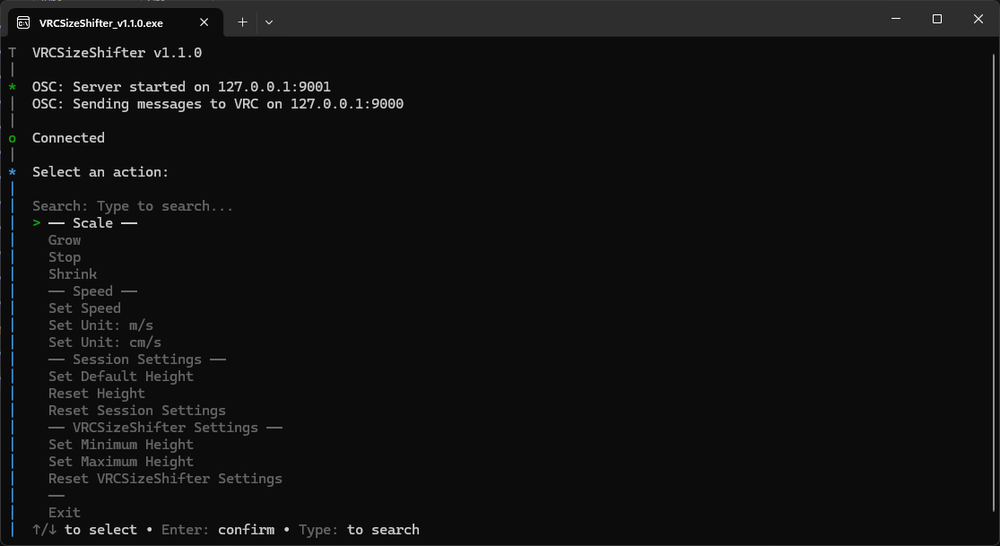
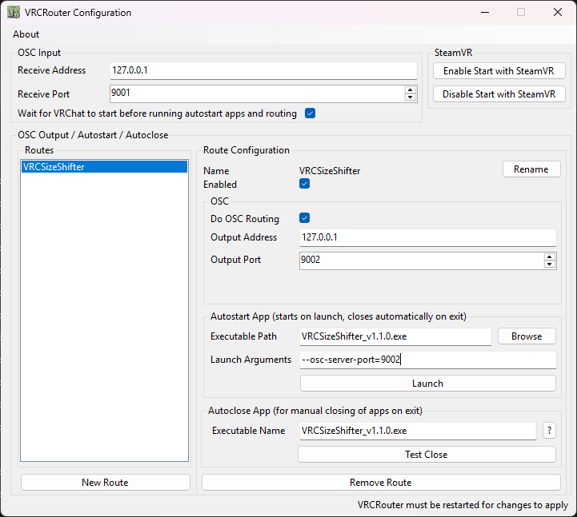

# Introduction



**VRCSizeShifter** is a VRChat scaling tool that allows more control and predictable avatar scaling. 
It uses the metric system instead of relative compared to other scaling system. And allows session restoration to allow extended sessions over multiple VRChat instances or sessions.

# Features

- **Metric scaling (meters/centimeters)**: Allows you precision for fast and slow speeds.
- **Interactive shell**: Control outside VRC to set the scaling parameters the need to re-upload your avatar.
- **Auto restoration**: Allows you to restore the avatar scaling session when the avatar is reloaded.

# Installation

This programs works just by executing the files but here is a little bit more info to configure VRCSizeShifter.

## Program

This program is configured to sends data to VRChat OSC on `127.0.0.1:9000` and receives information on port `127.0.0.1:9001` by default, but you can change the hosts and ports by setting the following launch arguments.

### Set the VRChat OSC host
```shell
VRCSizeShifter.exe --osc-client-host=192.168.x.x
```

### Set the VRChat OSC port
```shell
VRCSizeShifter.exe --osc-client-port=9005
```

### Set the VRSizeShifter OSC host
```shell
VRCSizeShifter.exe --osc-server-host=192.168.x.x
```

### Set the VRSizeShifter OSC port
```shell
VRCSizeShifter.exe --osc-server-port=9010
```

Since this program is not made to auto start with SteamVR, I recommend using a tool like VRCRouter that will allow to autostart and proxy OSC data to multiple OSC programs. Like mentionned before, you can set the launch arguments with `osc-server-port` to match the VRCRouter output port.



## VRChat

There is an available unity package to install VRCSizeShifter on your avatar, but if you want to make new additions, you can use the following parameters.

| Address | Description | Value |
| --- | --- | --- |
| /VRCSizeShifter/State | Set the scaling state. | float (Synced): -1 (shrink), 0 (stopped), 1 (grow) |
| /VRCSizeShifter/Rate | Set the scaling rate. | float (Synced) |
| /VRCSizeShifter/Rate/Unit | Set the scaling rate unit. | float (Synced): 0 (meters), 1 (centimeters) |
| /VRCSizeShifter/Rate/Meters | Set the scaling rate in meters. | float (Not Synced): 0-1 |
| /VRCSizeShifter/Rate/Centimeters (W) | Set the scaling rate in centimeters. | float (Not Synced): 0-1 |
| /VRCSizeShifter/ResetHeight | Reset the avatar height to the defined default height. | boolean (Not Synced) |
| /VRCSizeShifter/Settings/AutoRestore | Set whether to automatically restore the avatar scaling session when reloading the avatar. | boolean (Synced) |
| /VRCSizeShifter/Settings/ResetHeight | Set the default height to the current height of the avatar. (defined on first avatar load) | boolean (Not Synced) |

# Roadmap

You can see the upcoming features here!
Note that I am working on this on my free time, it might take a while for me to add new features.
https://wip.olliefops.com/1/public/boards/aSPNrUZxBcJZhzpBBTpii16o

# Small Developer Note

Little disclaimer that this program is fully coded by hand by myself, but I did use a little bit of AI with auto complete and to assist me with finding documentation for the packages and debugging logic. (My brain is really sometimes stops working lmao)

I am no software developer, so if there is some code that is not up to software dev coding standard, feel free to make a PR to show me what can be improved.

Enjoy!
